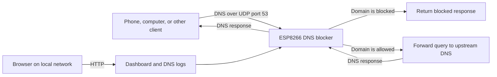

# ESP8266 DNS Blocker

A DNS-based ad and domain blocker for an ESP8266 NodeMCU. Devices use the ESP8266 as their DNS server; matching domains are blocked locally, while other requests are forwarded to public DNS resolvers.

This is an experimental hobby project, not a production security product. Test it on one device before changing your router's DNS settings.

## How it works



The generated blocklist uses a Bloom filter and a sorted hash file stored in LittleFS. Custom blocked domains are managed separately from the generated list.

## Features

- DNS filtering against a generated HaGeZi blocklist and a custom domain list.
- A local web dashboard with request statistics, live DNS logs, and blocklist management.
- Router Wi-Fi connection with a phone-hotspot fallback.
- Static router-network address configuration.
- Optional custom blocklist regeneration with `build_blocklist.py`.
- LittleFS storage for generated blocklist files and custom domains.

The local working copy may contain additional experimental features that are not yet present in the published source. The setup and feature list here describe the basic project available from the repository's current published revision.

## Hardware and software

- ESP8266 NodeMCU board with 4 MB flash (the PlatformIO environment is `nodemcuv2`).
- USB data cable and a computer that can access the board's serial port.
- Visual Studio Code with the PlatformIO IDE extension, or PlatformIO Core (`pio`).
- Python 3 if you want to regenerate the blocklist.
- A 2.4 GHz Wi-Fi network. The ESP8266 does not support 5 GHz Wi-Fi.

## First-time setup

1. Clone or download this repository and open its folder in VS Code.
2. Create your private Wi-Fi settings file by copying `src/secrets.example.h` to `src/secrets.h`.
3. Edit `src/secrets.h` with your router and optional hotspot SSIDs/passwords. This file is ignored by Git; do not commit it.
4. Choose an unused static address on your own LAN and set the matching IP, gateway, and subnet values in `src/secrets.h`. The example values use the reserved documentation network `192.0.2.0/24`; they are examples only and will not work on a real LAN.
5. Install the PlatformIO dependencies when prompted, then build:

   ```sh
   pio run -e nodemcuv2
   ```

6. Connect the board by USB and upload the firmware:

   ```sh
   pio run -e nodemcuv2 -t upload
   ```

7. Upload the LittleFS image if the device needs the generated blocklist or custom-domain file:

   ```sh
   pio run -e nodemcuv2 -t uploadfs
   ```

   **Warning:** Uploading a filesystem image replaces the ESP8266's LittleFS contents. Back up any custom domains or other data before doing this. The firmware and filesystem are separate uploads.

8. Open the PlatformIO serial monitor at 115200 baud:

   ```sh
   pio device monitor -b 115200
   ```

   Check the output for the connected Wi-Fi network and the board's assigned IP address.
9. From a device on the same local network, open `http://<ESP8266-IP>/` in a browser. For example, `http://192.0.2.50/` is a documentation-only example; replace it with the address configured for your own board.
10. Test DNS filtering with one client. Only after it works, configure your router or client to use the ESP8266 as its DNS server.

Keep the partition setting `board_build.ldscript = eagle.flash.4m2m.ld` in `platformio.ini`; changing the flash layout can prevent the filesystem or firmware from fitting.

## Network and privacy notes

- Addresses in `src/secrets.example.h` are RFC 5737 documentation examples, not real devices. Replace them with values appropriate for your own network.
- Do not put your Wi-Fi credentials, public IP, or other private network details in `README.md`, screenshots, logs, or commits. The local `src/secrets.h` file is Git-ignored.
- The dashboard and DNS service are intended for a trusted local network. HTTP is not encrypted; do not expose the dashboard or device to the public internet.
- DNS logs can reveal domains requested by devices on your network. Review and redact logs/screenshots before sharing them.
- Allowed DNS requests are sent to the configured upstream resolvers. Do not treat this project as a firewall or as a guarantee of anonymity.

## Dashboard

Open the dashboard at `http://<ESP8266-IP>/`. It provides live request information, aggregate counters, and controls for the custom blocklist. The device prints its current IP address to the serial monitor at startup.

### HTTP endpoints

| Path | Method | Purpose |
|---|---|---|
| `/` | GET | Dashboard |
| `/logs` | GET | Recent DNS log data |
| `/clear-logs` | POST | Clear the in-memory DNS log |
| `/api/stats` | GET | Aggregate request and device status |
| `/api/blocklist` | GET | List custom blocked domains |
| `/add?ajax=1&domain=example.com` | GET | Add a custom blocked domain |
| `/remove?domain=example.com` | GET | Remove a custom blocked domain |
| `/custom-blocks.txt` | GET | Download a custom-blocklist backup |

Use the dashboard for everyday management; the endpoints are provided for integrations and troubleshooting. URL-encode domain values when calling an endpoint directly.

## Regenerating the generated blocklist

The checked-in `data/` directory contains the generated LittleFS inputs. To download the current source list and recreate the generated files, run this from the repository root:

```sh
python build_blocklist.py
```

The script downloads the HaGeZi light list from the URL configured in the script and writes `data/bloom.bin` and `data/hashes.bin`. Review the script and upstream list source before running it. After regeneration, upload the filesystem image as described above; this replaces the filesystem contents on the device.

## Limitations

- DNS filtering applies only to devices configured to use this ESP8266 for DNS. Some devices or applications may use encrypted DNS or a hard-coded resolver and bypass it.
- The ESP8266 has limited RAM and processing capacity; this is intended for a small home or test network.
- A DNS block is not the same as blocking a web connection. It does not inspect page content, filter URLs, or stop connections to an IP address already known to a client.
- Network settings, upstream resolvers, and blocklist data are project configuration; review them before relying on the device.
- Build and test the firmware locally before using it as a network-wide DNS server.

## Troubleshooting

- **Build fails because `secrets.h` is missing:** copy `src/secrets.example.h` to `src/secrets.h` and fill in the values.
- **Board does not connect:** verify the SSID/password and the 2.4 GHz network. Confirm the static address, gateway, and subnet match your LAN.
- **Dashboard does not load:** read the board's IP address from the serial monitor and confirm your browser is on the same network.
- **No generated blocking:** check the serial output for missing or invalid blocklist files, then regenerate the list and upload the filesystem image.
- **DNS stops working after changing router settings:** restore the previous DNS settings and test the ESP8266 directly before trying again.

## License

See the repository's license file, if present.
