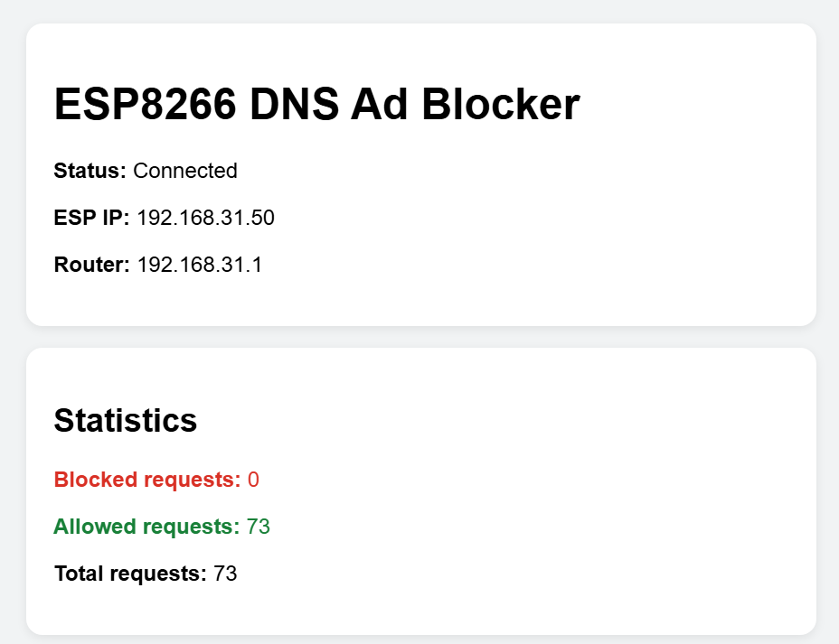
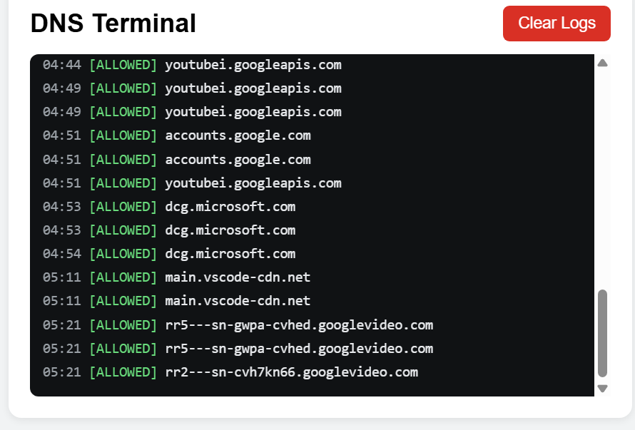
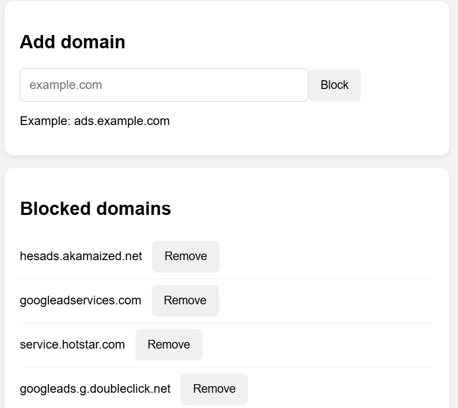

# ESP8266 DNS Ad Blocker

A lightweight **DNS-based ad and tracker blocker** built with an **ESP8266 NodeMCU V3**.

The ESP8266 acts as a local DNS server on an existing Wi-Fi network. Devices configured to use the ESP8266 as their DNS server send domain lookups to it. Blocked domains receive an `NXDOMAIN` response, while allowed domains are forwarded to an upstream DNS server.

> **Note:** DNS-level blocking can block many advertising, tracking, telemetry, and analytics domains, but it cannot guarantee removal of every in-stream advertisement. Services that deliver advertisements and video through the same infrastructure may not be safely blockable at the DNS level.

## Features

- DNS server running directly on the ESP8266
- Works with phones, computers, and other devices using the ESP8266 as DNS
- Static ESP8266 IP address
- Web dashboard hosted directly by the ESP8266
- Live DNS terminal
- Stores the latest **100 DNS request logs**
- **Clear Logs** button
- Allowed / blocked / total request statistics
- Manually add domains to the blocklist
- Remove manually added domains
- Subdomain matching
- Upstream DNS forwarding
- Designed for the limited resources of ESP8266 hardware

## Screenshots

### Dashboard



### Live DNS Terminal



### Blocked Domains



## Hardware

### Required

- ESP8266 NodeMCU V3 / ESP-12E
- USB cable
- Existing Wi-Fi router
- Computer for programming the ESP8266

## Network Configuration

The current setup uses:

| Device | Address |
|---|---|
| Router / Gateway | `192.168.0.1` |
| ESP8266 | `192.168.0.50` |
| DNS Port | `53` |
| Upstream DNS | `1.1.1.1` |

Change these values in the source code if your network uses a different subnet.

## How It Works

```text
                         INTERNET
                            |
                      +-----+------+
                      |   ROUTER   |
                      |192.168.0.1|
                      +-----+------+
                            |
             +--------------+--------------+
             |                             |
          Phone / PC                    ESP8266
                                      192.168.0.50
                                            |
                                      DNS requests
                                            |
                                   +--------+--------+
                                   |                 |
                                BLOCKED           ALLOWED
                                   |                 |
                                NXDOMAIN       1.1.1.1 DNS
                                                     |
                                                     v
                                                  Internet
```

The ESP8266 does **not** proxy normal internet traffic.

Only DNS lookups are sent to the ESP8266. Once a domain is allowed and resolved, the actual HTTP/HTTPS/video traffic goes directly through the router.

## Web Dashboard

The ESP8266 provides a web interface at:

```text
http://192.168.0.50
```

The dashboard shows:

- Connection status
- ESP8266 IP address
- Router address
- Blocked request count
- Allowed request count
- Total request count
- Live DNS terminal
- Manual domain blocking
- Blocked-domain management

### DNS Terminal

The terminal stores the **latest 100 DNS requests**.

Example:

```text
04:44 [ALLOWED] youtubei.googleapis.com
04:49 [ALLOWED] youtubei.googleapis.com
04:51 [ALLOWED] accounts.google.com
04:53 [ALLOWED] dcg.microsoft.com
05:21 [ALLOWED] rr5---sn-gwpa-cvhed.googlevideo.com
```

Blocked requests appear as:

```text
[BLOCKED] example.com
```

When request number 101 arrives, the oldest entry is removed automatically.

The **Clear Logs** button clears the terminal history stored in ESP8266 RAM.

> Log history is temporary and is cleared when the ESP8266 restarts.

## Manual Domain Blocking

A domain can be added from the dashboard:

```text
ads.example.com
```

Subdomain matching is supported. For example, blocking:

```text
example.com
```

also matches:

```text
ads.example.com
tracking.example.com
sub.example.com
```

## DNS Behavior

### Allowed domain

```text
Device
   |
   | DNS: google.com
   v
ESP8266
   |
   | Not blocked
   v
1.1.1.1
   |
   v
DNS response
   |
   v
Device
```

### Blocked domain

```text
Device
   |
   | DNS: ads.example.com
   v
ESP8266
   |
   | Blocked
   v
NXDOMAIN
   |
   v
Device
```

## Setup

### 1. Install PlatformIO

This project can be developed using:

- VS Code
- PlatformIO extension
- ESP8266 PlatformIO platform

Android Studio is **not required**.

### 2. Configure Wi-Fi

Edit the Wi-Fi credentials in `src/main.cpp`:

```cpp
const char *WIFI_SSID = "YOUR_WIFI_NAME";
const char *WIFI_PASSWORD = "YOUR_WIFI_PASSWORD";
```

### 3. Configure the Static IP

Example:

```cpp
IPAddress localIP(192, 168, 0, 50);
IPAddress gateway(192, 168, 0, 1);
IPAddress subnet(255, 255, 255, 0);
```

Change these values if necessary.

### 4. Build

In PlatformIO:

```text
Build
```

### 5. Upload Firmware

Connect the NodeMCU through USB and select:

```text
Upload
```

### 6. Open Serial Monitor

Use:

```text
115200 baud
```

The ESP8266 should report its Wi-Fi connection and IP address.

### 7. Open the Dashboard

From a device connected to the same Wi-Fi:

```text
http://192.168.0.50
```

## Configure a Phone

Configure the connected Wi-Fi network to use the ESP8266 as its DNS server.

Example:

```text
IP settings: Static
Gateway: 192.168.0.1
Network prefix length: 24
DNS 1: 192.168.0.50
```

For testing, avoid a secondary DNS server that bypasses the ESP8266.

On Android, set **Private DNS to Off** during testing because Private DNS uses encrypted DNS rather than the normal Wi-Fi DNS path.

Menu names can vary by Android version and manufacturer.

## Test the DNS Server

From Windows:

```powershell
nslookup google.com 192.168.0.50
```

A normal domain should resolve through the ESP8266.

For a manually blocked domain:

```powershell
nslookup example.com 192.168.0.50
```

The blocked request should return a non-existent-domain result.

The request should also appear in the ESP8266 Serial Monitor and web terminal.

## Applications and Streaming Services

The blocker can work with applications as well as websites when those applications use the device's normal DNS configuration.

It can therefore be tested with browsers, streaming applications, social-media applications, and other networked applications.

However, applications can bypass DNS filtering using:

- DNS-over-HTTPS (DoH)
- DNS-over-TLS (DoT)
- Hard-coded DNS
- Cached DNS results
- Other application-specific networking methods

### JioHotstar / SonyLIV

DNS blocking may block independently hosted advertising or tracking domains.

However, an advertisement may be delivered from the same infrastructure as the actual video stream. Blocking that host can break playback instead of removing the advertisement.

For example:

```text
https://hesads.akamaized.net/.../segment-2.ts
```

is an HLS video segment request. Blocking the entire host is therefore not necessarily a safe way to remove an advertisement.

This is a fundamental limitation of DNS-level ad blocking.

## Blocklist

For larger maintained blocklists, the project can use an optimized representation instead of storing thousands of domain strings directly in ESP8266 RAM.

The optimized approach can use:

1. A Bloom filter for fast negative checks
2. A sorted hash database for exact verification
3. LittleFS flash storage

Example project data files:

```text
data/
├── bloom.bin
└── hashes.bin
```

Temporary source blocklist files should not be placed in `data/` because they consume filesystem space unnecessarily.

## PlatformIO Configuration

The NodeMCU V3 / ESP-12E hardware is commonly configured using the NodeMCU V2-compatible PlatformIO board definition:

```ini
[env:nodemcuv2]
platform = espressif8266
board = nodemcuv2
framework = arduino

monitor_speed = 115200

board_build.filesystem = littlefs
```

## Project Structure

```text
ESP8266-DNS-Ad-Blocker/
│
├── data/
│   ├── bloom.bin
│   └── hashes.bin
│
├── screenshots/
│   ├── dashboard.png
│   ├── dns-terminal.png
│   └── blocked-domains.png
│
├── src/
│   └── main.cpp
│
├── platformio.ini
│
└── README.md
```

## Performance Considerations

ESP8266 has limited RAM, so large text blocklists should not simply be loaded into memory.

The optimized blocklist approach keeps the large data in LittleFS flash and uses compact lookup structures.

The DNS implementation also separates the client-facing DNS socket from the upstream DNS socket so that the original client endpoint can be preserved while forwarding DNS requests.

For many simultaneous clients, an asynchronous DNS implementation would be a useful future improvement.

## Limitations

- DNS filtering is not a full HTTP/HTTPS ad blocker.
- HTTPS content cannot be inspected by this DNS server.
- Ads served from the same infrastructure as requested content may not be safely blockable.
- Some applications can bypass normal DNS.
- DNS caching can delay changes.
- Terminal logs are stored only in RAM.
- ESP8266 hardware has limited RAM and processing resources.
- The ESP8266 must remain powered for DNS filtering to remain available.

## Security

**Never commit real Wi-Fi credentials to a public GitHub repository.**

Use:

```cpp
const char *WIFI_SSID = "YOUR_WIFI_NAME";
const char *WIFI_PASSWORD = "YOUR_WIFI_PASSWORD";
```

If real credentials have already been pushed to a public repository, change the Wi-Fi password.

## Future Improvements

- Persistent blocklist storage
- Allowlist support
- DNS caching
- Fully asynchronous DNS handling
- Router-wide DHCP DNS configuration
- Automatic blocklist updates
- More detailed statistics
- Per-device statistics
- DNS terminal search/filter
- DNS log export
- Query response-time statistics
- Automatic blocklist refresh

## Disclaimer

This project is intended for **personal, educational, and network-administration purposes**.

Use it only on networks and devices that you are authorized to manage.

## License

This project can be released under a license appropriate for your intended use. The MIT License is one simple option for open-source distribution.

---

**Built with:** ESP8266 · Arduino · PlatformIO · DNS · LittleFS
