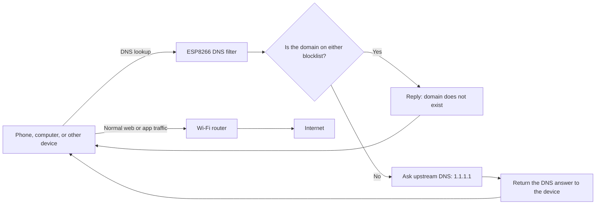
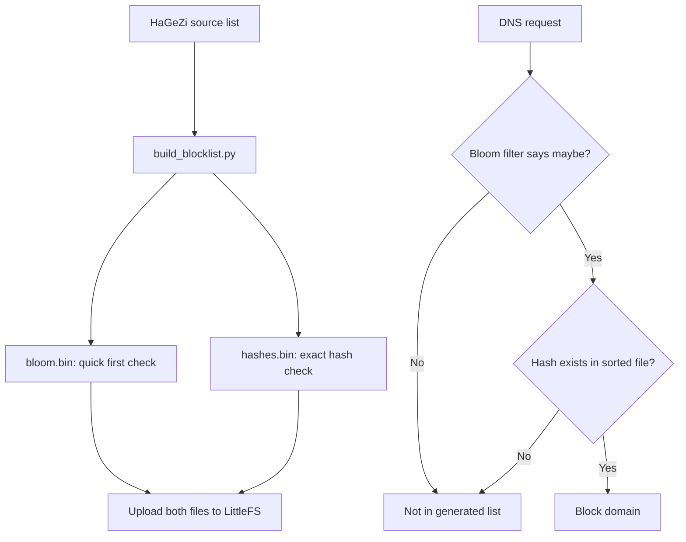

# ESP8266 DNS Ad Blocker

A small DNS filter that runs on an ESP8266 NodeMCU. It checks the domain names requested by devices on your Wi-Fi network. It blocks matching domains and asks an upstream DNS server to look up everything else.

This project is for people who want to learn about DNS filtering or manage their own network. It does not inspect web pages or act as a general internet firewall. This Project Corrently Have 78,373 add Url's And 23 Custom Url's in custome_blocks.txt for blocking add on some of the OTT Plaforms. 

## What it does

- Runs a DNS server on the ESP8266.
- Blocks domains from a custom list and, optionally, a generated HaGeZi blocklist.
- Also blocks subdomains of a blocked domain. For example, blocking `example.com` blocks `ads.example.com`.
- Forwards other DNS requests to Cloudflare DNS (`1.1.1.1`).
- Hosts a web dashboard with request counts, a live log, and custom blocklist controls.
- Saves custom blocked domains in the ESP8266's LittleFS flash storage.

## Screenshots

### Dashboard


### Live DNS log


### Custom blocklist


## How a request is handled



Only DNS lookups pass through the ESP8266. After a domain is resolved, the device connects to the website or service through the router as usual.

## What you need

- An ESP8266 NodeMCU V3 / ESP-12E board
- A USB cable and a computer
- A 2.4 GHz Wi-Fi network (the ESP8266 does not support 5 GHz Wi-Fi)
- VS Code with the PlatformIO extension

## Network settings

The current defaults in [`src/main.cpp`](src/main.cpp) are:

| Setting | Default |
| --- | --- |
| ESP8266 address on the router network | `192.168.0.50` |
| Router / gateway | `192.168.0.1` |
| Network mask | `255.255.255.0` |
| DNS server used for lookups | `1.1.1.1` |
| DNS port | UDP `53` |
| Dashboard port | HTTP `80` |

These are example defaults, not requirements for every network. Before using them, check your router's address and choose an ESP8266 address in the same subnet that is not already in use. A DHCP reservation in your router is a good way to prevent an address conflict.

The firmware tries the configured router Wi-Fi first, then the configured mobile hotspot. It uses the static address above on the router network and DHCP on the hotspot. If it connects to the hotspot, read the actual address from the Serial Monitor.

## Install and configure

1. Install VS Code and the PlatformIO extension.
2. Open this project in VS Code.
3. Create `src/secrets.h` on your computer. This file is excluded from Git. Add your own Wi-Fi names and passwords in this format:

   ```cpp
   #pragma once

   #define ROUTER_SSID "YOUR_ROUTER_WIFI_NAME"
   #define ROUTER_PASSWORD "YOUR_ROUTER_WIFI_PASSWORD"

   #define HOTSPOT_SSID "YOUR_HOTSPOT_NAME"
   #define HOTSPOT_PASSWORD "YOUR_HOTSPOT_PASSWORD"
   ```

   If you do not want to use a hotspot, set its name and password to values for a network you control. The firmware expects all four definitions.

4. If your router uses a different network range, update `localIP`, `gateway`, and `subnet` near the beginning of `src/main.cpp`. Make sure the ESP8266 address is available and that the gateway and subnet match your network.
5. Connect the board by USB, then use PlatformIO's **Build** and **Upload** actions.
6. Open the PlatformIO Serial Monitor at **115200 baud**. Note the IP address printed after Wi-Fi connects.
7. In a browser on the same Wi-Fi network, open `http://<ESP8266-IP>` (for example, `http://192.168.0.50` when using the default router-network address).

Keep `src/secrets.h` private. Do not put real Wi-Fi passwords in source files that you commit or publish.

## Make devices use the filter

The ESP8266 only filters requests from devices that send their DNS lookups to it.

For a single device, open its Wi-Fi network settings and set its DNS server to the ESP8266's IP address (IP Can Vary). Keep the device on the same network as the ESP8266. For example:

| Device setting | Example |
| --- | --- |
| DNS server | `192.168.0.50` |
| Gateway | Your router's address, such as `192.168.0.1` |

For network-wide use, configure your router's DHCP/DNS settings to give clients the ESP8266 address as their DNS server, if the router supports that. Do not configure the router's own upstream DNS as the ESP8266 unless the router supports the required DNS forwarding setup.

On Android, turn **Private DNS** off while testing. Private DNS and other encrypted DNS options can bypass the normal DNS setting. A second DNS server can also allow a device to bypass the filter.

## Test it

From Windows, ask the ESP8266 to resolve a normal domain (IP Addres Can Vary):

```powershell
nslookup example.org 192.168.0.50
```

To test blocking, first add a test domain such as `example.com` in the dashboard, then run:

```powershell
nslookup example.com 192.168.0.50
```

The blocked lookup should report that the domain does not exist. Requests should also appear in the dashboard's live log and in the Serial Monitor.

## Dashboard

The dashboard is hosted by the ESP8266; it does not need a separate server or internet connection to display.

- **Overview:** blocked, allowed, and total request counts, plus the block rate.
- **Live log:** the latest 100 requests, with filters and domain search. The time shown is elapsed time since the ESP8266 started, not the current clock time.
- **Blocklist:** add or remove custom domains and download a backup of the custom list.
- **System:** Wi-Fi status, network details, uptime, storage use, and memory information.

The request counters and log are held in RAM and reset when the board restarts. Clearing the logs only clears the log; it does not reset the counters or remove blocked domains.

Custom entries are saved in LittleFS and limited to 150 domains. Download a backup from the dashboard before uploading a new filesystem image: an upload can replace the files stored in the ESP8266's flash.

## Blocklists

The project has two separate sources of blocked domains:

| List | What it contains | Where it is stored | How to manage it |
| --- | --- | --- | --- |
| Custom list | Domains added in the dashboard | LittleFS file `custom_blocks.txt` | Add, remove, or download a backup in the dashboard |
| Generated list | Domains converted from the HaGeZi Multi LIGHT list | LittleFS files `bloom.bin` and `hashes.bin` | Build with `build_blocklist.py`, then upload the filesystem |

Either list can block a lookup. The generated list is optional: if its files are missing or invalid, custom blocking still works.

### Build or refresh the generated list (optional)

The Python script downloads the latest HaGeZi Multi LIGHT source list, converts it into compact lookup files, and removes its temporary download when it finishes. Run these commands from the project folder:

```powershell
python build_blocklist.py
```

Then use PlatformIO's **Upload Filesystem Image** action, or run:

```powershell
pio run -t uploadfs
```

Uploading a filesystem image can replace the ESP8266's existing LittleFS contents, including custom domains added through the dashboard. Download the custom list first and restore it after the upload if needed.

## How the generated list is checked

The generated list uses a compact Bloom filter to quickly reject most domains that are not listed. If the Bloom filter says a domain might be listed, the firmware checks for matching hash values in a sorted file. This second check prevents Bloom-filter-only false positives from being blocked.



The dashboard's custom list is checked as well. A match in either list blocks the requested domain and its subdomains.

## Project files

```text
.
├── build_blocklist.py       # Downloads and converts the generated blocklist
├── data/
│   ├── bloom.bin            # Generated Bloom filter
│   ├── custom_blocks.txt    # Custom list copied to LittleFS
│   └── hashes.bin           # Generated sorted hash data
├── screenshots/             # Dashboard screenshots
├── src/
│   ├── dashboard_ui.h       # Dashboard page
│   ├── main.cpp             # DNS server, Wi-Fi, and web server
│   └── secrets.h            # Your local Wi-Fi credentials; ignored by Git
└── platformio.ini           # Board and build settings
```

The `data` directory is the source for the filesystem image uploaded to LittleFS. The Python builder creates or replaces the generated blocklist files there.

## Limitations

- This is DNS filtering, not a full ad blocker. It cannot inspect HTTPS pages or remove ads embedded in a video stream.
- An app may bypass the configured DNS server using encrypted DNS, its own resolver, or cached answers.
- Blocking a domain used for both ads and normal content may break the service rather than remove only its ads.
- The ESP8266 has limited memory and is best suited to a small home or test network. This firmware handles DNS requests one at a time.
- DNS filtering stops while the ESP8266 is powered off or disconnected.
- Changes can take time to appear because devices and applications may cache DNS answers.

## Safety and privacy

Use this only on networks and devices you own or are authorized to manage. Keep Wi-Fi credentials private, and remember that request logs show domain names looked up by connected devices. The logs and request counters are stored only in RAM and are not retained after a restart.

## License

There is currently no `LICENSE` file in this repository. Add a license file before redistributing the project or setting terms for reuse.

---

Built with ESP8266, Arduino, PlatformIO, DNS, and LittleFS.
